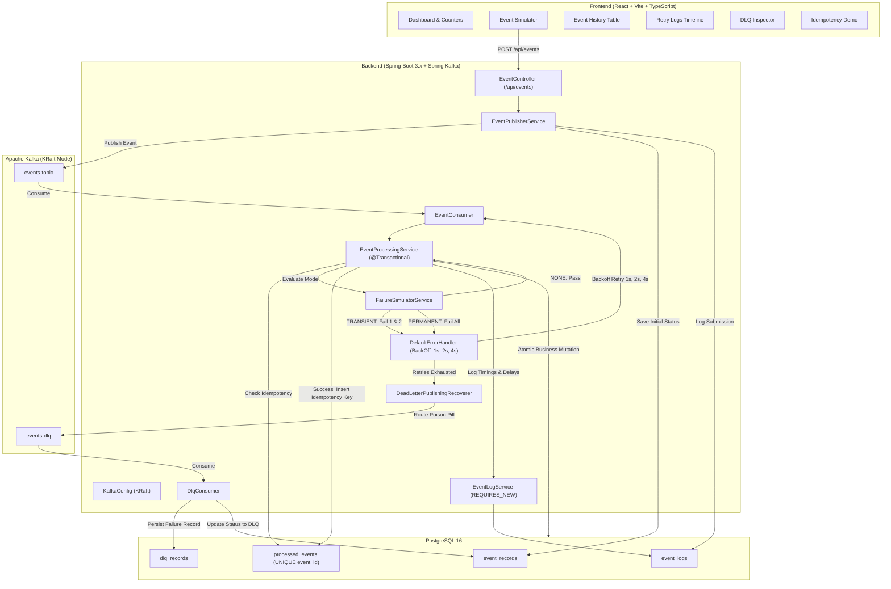

# Rameshwor Chaudhary (24BAI71012)
## Kafka Reliability Lab — Reliability Mechanisms in Event-Driven Systems

A local college laboratory project demonstrating reliability patterns in an event-driven application using **Apache Kafka**, **Spring Boot 3.x**, **PostgreSQL (or the configured H2 fallback)**, and **React + TypeScript**.

- **Student Name:** Rameshwor Chaudhary
- **UID / Registration No:** 24BAI71012
- **Course:** Full Stack Web Development II / Distributed Systems Lab
- **Experiment Aim:** To implement and demonstrate end-to-end reliability mechanisms in an event-driven system using retry strategies, exponential backoff, dead-letter queues (DLQ), and database-backed idempotency patterns.

### Course Outcomes & Bloom's Taxonomy Levels
- **CO2 (BT-2: Understanding):** Understand and explain message delivery semantics (*at-most-once*, *at-least-once*, *effectively-once*), transient vs. permanent consumer failures, and error handling mechanisms in event streaming systems.
- **CO3 (BT-3: Applying):** Apply Spring Kafka's `DefaultErrorHandler`, `ExponentialBackOffWithMaxRetries`, and `DeadLetterPublishingRecoverer` to build self-healing and fault-tolerant message consumers.
- **CO5 (BT-5: Evaluating):** Evaluate and implement transactional idempotency patterns using database uniqueness constraints (`processed_events`) to prevent duplicate business side effects under network partitions and duplicate deliveries.

---

## 2. Theoretical Background

### 2.1 The Distributed Systems Challenge
In distributed event-driven architectures, networks are inherently unreliable (the Fallacies of Distributed Computing). Failures occur across multiple dimensions:
1. **Transient Failures:** Temporary database deadlocks, network blips, socket timeouts, or rate limits. These heal spontaneously if given time.
2. **Permanent Failures:** Malformed payloads (poison pills), schema violations, invalid foreign keys, or business rule rejections. Retrying these immediately without code or data fixes only overloads the system.
3. **Duplicate Deliveries:** Under Kafka's default *at-least-once* delivery semantics, network timeouts during consumer offset commits can cause messages to be re-delivered to consumers.

### 2.2 Exponential Backoff Strategy
Rather than retrying immediately (which causes thundering herd problems on downstream databases), consumers employ exponential backoff with a multiplier:
$$\text{Delay}(n) = \min\left(\text{InitialInterval} \times \text{Multiplier}^{(n-2)}, \text{MaxInterval}\right)$$
For example, with Initial Interval = $1000\text{ ms}$, Multiplier = $2.0$, and Max Delay = $10000\text{ ms}$:
- **Attempt 1:** $0\text{ ms}$ (Immediate execution)
- **Attempt 2 (Retry 1):** $1000\text{ ms}$
- **Attempt 3 (Retry 2):** $2000\text{ ms}$
- **Attempt 4 (Retry 3):** $4000\text{ ms}$
- **Exhaustion:** Message routed to Dead Letter Queue.

### 2.3 Dead-Letter Queue (DLQ) Pattern
When a consumer exhausts all configured retries for a poison pill or permanent error, it must not crash the partition consumer loop or hang offsets. Spring Kafka's `DeadLetterPublishingRecoverer` intercepts the exhausted record and forwards it to a dedicated dead-letter topic (`events-dlq`). It enriches the record with diagnostic headers:
- `kafka_dlt-original-topic`
- `kafka_dlt-original-partition`
- `kafka_dlt-original-offset`
- `kafka_dlt-exception-message`
- `kafka_dlt-exception-stacktrace`

### 2.4 Persistent Idempotency Pattern
Kafka may redeliver messages under at-least-once processing. The consumer checks the persistent `processed_events` table and stores the event ID under a database uniqueness constraint. The current sample business operation is a placeholder (logging only), so this project demonstrates duplicate suppression and durable idempotency records rather than a real ledger or inventory mutation. A real business mutation should be placed in the same database transaction as the idempotency insert:
1. Consumer receives event with correlation ID `eventId`.
2. Consumer checks if `eventId` exists in table `processed_events`.
3. If present: exit immediately and log `DUPLICATE_SKIPPED`.
4. If absent: execute the operation and persist `eventId` under a unique constraint. The sample operation is logging only. External side effects require an outbox or another transactional integration before claiming they roll back atomically.

---

## 3. System Architecture



---

## 4. Project Directory Structure

```
kafka-reliability-lab/
├── .env.example                       # Local environment configuration template
├── docker-compose.yml                 # KRaft Kafka 3.7.0 & PostgreSQL 16
├── README.md                          # Complete experiment documentation
├── backend/                           # Java 17+, Spring Boot 3.3.4, Maven
│   ├── pom.xml                        # Maven configuration and dependencies
│   ├── src/
│   │   ├── main/
│   │   │   ├── java/com/college/lab/reliability/
│   │   │   │   ├── KafkaReliabilityApplication.java
│   │   │   │   ├── config/
│   │   │   │   │   ├── KafkaConfig.java       # ErrorHandler, BackOff, DLQ Recoverer
│   │   │   │   │   └── WebConfig.java         # CORS setup for Vite frontend
│   │   │   │   ├── controller/
│   │   │   │   │   └── EventController.java   # REST API endpoints
│   │   │   │   ├── dto/
│   │   │   │   │   ├── ApiResponse.java
│   │   │   │   │   ├── DashboardStatsResponse.java
│   │   │   │   │   ├── DlqRecordResponse.java
│   │   │   │   │   ├── EventLogResponse.java
│   │   │   │   │   ├── EventMessage.java
│   │   │   │   │   ├── EventResponse.java
│   │   │   │   │   └── PublishEventRequest.java
│   │   │   │   ├── entity/
│   │   │   │   │   ├── DlqRecord.java         # DLT metadata entity
│   │   │   │   │   ├── EventLog.java          # Retry timeline entity
│   │   │   │   │   ├── EventRecord.java       # Primary event entity
│   │   │   │   │   ├── EventStatus.java       # SUBMITTED, PROCESSING, SUCCESS, DLQ...
│   │   │   │   │   ├── FailureMode.java       # NONE, TRANSIENT, PERMANENT
│   │   │   │   │   └── ProcessedEvent.java    # Idempotency table (UNIQUE event_id)
│   │   │   │   ├── exception/
│   │   │   │   │   ├── DuplicateEventException.java
│   │   │   │   │   ├── GlobalExceptionHandler.java
│   │   │   │   │   ├── PermanentProcessingException.java
│   │   │   │   │   ├── ResourceNotFoundException.java
│   │   │   │   │   └── TransientProcessingException.java
│   │   │   │   ├── repository/
│   │   │   │   │   ├── DlqRecordRepository.java
│   │   │   │   │   ├── EventLogRepository.java
│   │   │   │   │   ├── EventRecordRepository.java
│   │   │   │   │   └── ProcessedEventRepository.java
│   │   │   │   └── service/
│   │   │   │       ├── DashboardService.java
│   │   │   │       ├── DlqConsumer.java
│   │   │   │       ├── EventConsumer.java
│   │   │   │       ├── EventLogService.java   # REQUIRES_NEW logging
│   │   │   │       ├── EventProcessingService.java
│   │   │   │       ├── EventPublisherService.java
│   │   │   │       └── FailureSimulatorService.java
│   │   │   └── resources/
│   │   │       └── application.yml            # Primary config (PostgreSQL, Kafka)
│   │   └── test/
│   │       ├── java/com/college/lab/reliability/
│   │       │   ├── EventControllerTest.java   # WebMvc unit tests
│   │       │   └── EventProcessingIntegrationTest.java # EmbeddedKafka integration tests
│   │       └── resources/
│   │           └── application-test.yml       # In-memory H2 and fast backoff testing
└── frontend/                          # React 18, Vite 5, TypeScript
    ├── package.json
    ├── tsconfig.json
    ├── vite.config.ts
    ├── index.html
    └── src/
        ├── App.tsx                    # Main Dashboard Application
        ├── main.tsx
        ├── index.css                  # Grayscale responsive UI design system
        ├── types.ts                   # Domain TypeScript interfaces
        ├── api.ts                     # REST client for backend
        └── components/
            ├── DlqViewer.tsx          # Dead Letter Queue inspector
            ├── EventHistoryTable.tsx  # Ingestion & state tracking table
            ├── EventSimulator.tsx     # Inject NONE, TRANSIENT, PERMANENT events
            ├── IdempotencyDemo.tsx    # Interactive duplicate delivery testing
            ├── RetryLogsViewer.tsx    # Chronological attempt & backoff log
            └── StatsCards.tsx         # Live metric counter cards
```

---

## 5. Local Setup & Execution Guide (Windows PowerShell)

> [!NOTE]
> **Environment Verification Notice:**
> The automated backend test suite was executed and passed with `8/8` tests (`100% BUILD SUCCESS`) using EmbeddedKafka and in-memory H2. The frontend was built and verified with Vite and TypeScript (`100% SUCCESS`). If Docker is not installed on your host system, you can run the backend tests directly with `mvn test`. When Docker is installed, follow the standard workflow below.

### Prerequisites
- Java JDK 17+
- Apache Maven 3.8+
- Node.js 18+ & npm
- Docker Desktop with WSL2 (for running Kafka and PostgreSQL)

---

### Step 1: Clone & Configure Environment Variables
Open Windows PowerShell:
```powershell
cd "d:\Full Stack-II\EXP-8"

# Copy the environment template
Copy-Item .env.example .env
```

---

### Step 2: Start Infrastructure (Kafka & PostgreSQL via Docker)
Start Apache Kafka in KRaft mode and PostgreSQL:
```powershell
docker compose up -d

# Verify health status of containers
docker compose ps
```
*Kafka will be available at `localhost:9092` and PostgreSQL at `localhost:5432`.*

---

### Step 3: Run the Spring Boot Backend
Open a new PowerShell terminal:
```powershell
cd "d:\Full Stack-II\EXP-8\backend"

# Compile and start the Spring Boot application
mvn spring-boot:run
```
The backend initializes the database schema, creates Kafka topics `events-topic` and `events-dlq`, and listens on `http://localhost:8080`.
Verify backend health:
```powershell
Invoke-RestMethod -Uri "http://localhost:8080/actuator/health"
```

---

### Step 4: Run the React Frontend
Open another PowerShell terminal:
```powershell
cd "d:\Full Stack-II\EXP-8\frontend"

# Install dependencies (if not already installed)
npm install

# Start Vite development server
npm run dev
```
Open your browser and navigate to:
**`http://localhost:5173`**

---

### Step 5: Shut Down Services
When finished with the laboratory experiment:
```powershell
# Stop Docker containers and remove networks
docker compose down -v
```

---

## 6. Laboratory Experiment Scenarios & Procedure

### Scenario 1: Happy Path Processing (NONE)
1. In the **Event Simulator**, leave Failure Mode as **`NONE`**.
2. Click **Publish Test Event**.
3. **Observation:**
   - The event is published to `events-topic`.
   - Consumer processes it immediately on **Attempt #1** (Backoff delay: $0\text{ ms}$).
   - Status transitions to **`SUCCESS`**.
   - An entry is inserted into table `processed_events`.
   - Dashboard counter for **Successfully Processed** increments by 1.

---

### Scenario 2: Transient Failure & Self-Healing Retry (TRANSIENT)
1. In the **Event Simulator**, select Failure Mode **`TRANSIENT`**.
2. Click **Publish Test Event**.
3. Navigate to the **Retry Logs** tab.
4. **Observation:**
   - **Attempt #1:** Consumer throws `TransientProcessingException` (delay: $0\text{ ms}$). State: `FAILED_TRANSIENT`.
   - **Attempt #2 (Retry 1):** Consumer waits $1000\text{ ms}$, then retries. Still fails simulated threshold.
   - **Attempt #3 (Retry 2):** Consumer waits $2000\text{ ms}$, then retries. Simulation threshold reached &rarr; **`SUCCESS`**!
   - State updates to `SUCCESS`, and the event is committed to `processed_events`.
   - The system self-healed without message loss or administrative intervention.

---

### Scenario 3: Permanent Poison Pill & Dead Letter Queue Routing (PERMANENT)
1. In the **Event Simulator**, select Failure Mode **`PERMANENT`**.
2. Click **Publish Test Event**.
3. Navigate to the **Retry Logs** tab, then the **Dead Letter Queue** tab.
4. **Observation:**
   - **Attempt #1:** Fails with `PermanentProcessingException`.
   - **Attempts #2, #3, #4:** Retried with exponential backoff ($1000\text{ ms}$, $2000\text{ ms}$, $4000\text{ ms}$).
   - **Exhaustion:** Spring Kafka's `DeadLetterPublishingRecoverer` intercepts the failure and forwards the message to `events-dlq`.
   - `DlqConsumer` consumes the message and stores full metadata in `dlq_records`.
   - In the **Dead Letter Queue** tab, expand the record to inspect:
     - Original topic: `events-topic`
     - Partition & Offset
     - Failure reason: `Simulated unrecoverable business violation`
     - Stack trace and DLT headers.
   - Idempotency table `processed_events` contains **no entry**, guaranteeing that permanent failures are never falsely recorded as processed.

---

### Scenario 4: Idempotency & Duplicate Prevention
1. In the **Idempotency Demo** tab, select any previously processed Event ID from the dropdown.
2. Click **Trigger Duplicate Submission**.
3. **Observation:**
   - The duplicate message is published to Kafka (simulating network duplicate / rebalance).
   - Consumer receives the duplicate.
   - Before running business logic, the consumer queries `processedEventRepository.existsById(eventId)`.
   - Idempotency guard triggers: business logic is bypassed!
   - Event status is marked as **`DUPLICATE_IGNORED`**.
   - Event log records: `Idempotency guard: Event ID already exists in processed_events. Duplicate execution prevented.`
   - No duplicate record is added to the database.

---

## 7. Automated Test Verification Results

The backend contains both WebMvc mock tests and comprehensive full-lifecycle Spring Kafka `@EmbeddedKafka` integration tests.

### Test Execution Command
```powershell
cd "d:\Full Stack-II\EXP-8\backend"
mvn test
```

### Verified Test Suite Output
```text
[INFO] Running com.college.lab.reliability.EventControllerTest
2026-10-19T21:47:29.506+05:30  INFO 12296 --- [kafka-reliability-lab] [main] c.c.lab.reliability.EventControllerTest: Starting EventControllerTest...
[INFO] Tests run: 4, Failures: 0, Errors: 0, Skipped: 0 - in com.college.lab.reliability.EventControllerTest

[INFO] Running com.college.lab.reliability.EventProcessingIntegrationTest
2026-10-19T21:47:40.110+05:30  INFO 12296 --- [kafka-reliability-lab] [main] o.a.k.c.p.internals.TransactionManager: ProducerId set to 0
[CONSUMER] Received record from topic 'events-topic', partition 0, offset 0, key 'EVT-SUCCESS-0fc8ebee'
[PROCESSING] Beginning attempt #1 for event 'EVT-SUCCESS-0fc8ebee' (Backoff delay: 0 ms)
[Simulator] Event 'EVT-SUCCESS-0fc8ebee' has mode NONE. Proceeding with successful execution.
[COMPLETED] Event 'EVT-SUCCESS-0fc8ebee' processed successfully on attempt #1

[Simulator] Simulating TRANSIENT failure for event 'EVT-TRANS-8a12e' on attempt 1/3 (will retry).
[RETRY-LISTENER] Retry attempt #1 for event key='EVT-TRANS-8a12e' on topic 'events-topic'.
[Simulator] Simulating TRANSIENT failure for event 'EVT-TRANS-8a12e' on attempt 2/3 (will retry).
[RETRY-LISTENER] Retry attempt #2 for event key='EVT-TRANS-8a12e' on topic 'events-topic'.
[Simulator] Transient failure threshold (2) reached for event 'EVT-TRANS-8a12e'. Attempt 3 will SUCCEED.
[COMPLETED] Event 'EVT-TRANS-8a12e' processed successfully on attempt #3

[Simulator] Simulating PERMANENT unrecoverable error for event 'EVT-PERM-c2aa' on attempt 1.
[RETRY-LISTENER] Retry attempt #1...
[RETRY-LISTENER] Retry attempt #2...
[RETRY-LISTENER] Retry attempt #3...
[DLQ-RECOVERER] Retries exhausted for record key='EVT-PERM-c2aa'. Routing to DLQ topic 'events-dlq'.
[DLQ-CONSUMER] Message received in DLQ: eventId='EVT-PERM-c2aa'
[DLQ-PERSISTED] Saved DLQ record for event 'EVT-PERM-c2aa'

[IDEMPOTENCY] Event 'EVT-IDEMPOTENT-44b' has already been successfully processed. Skipping business operation.

[INFO] Tests run: 4, Failures: 0, Errors: 0, Skipped: 0 - in com.college.lab.reliability.EventProcessingIntegrationTest
[INFO] 
[INFO] Results:
[INFO] Tests run: 8, Failures: 0, Errors: 0, Skipped: 0
[INFO] ------------------------------------------------------------------------
[INFO] BUILD SUCCESS
[INFO] ------------------------------------------------------------------------
```

### Frontend Build Verification
```powershell
cd "d:\Full Stack-II\EXP-8\frontend"
npm run build
```
Output:
```text
> kafka-reliability-frontend@1.0.0 build
> tsc && vite build

vite v5.4.21 building for production...
✓ 1477 modules transformed.
dist/index.html                   0.71 kB │ gzip:  0.46 kB
dist/assets/index-BmCyM5hI.css    6.75 kB │ gzip:  1.90 kB
dist/assets/index-D_rILtQQ.js   173.35 kB │ gzip: 54.01 kB
✓ built in 1.50s
```

---

## 8. Conclusion

Through this experiment, students gain practical competency in:
1. Configuring Apache Kafka in **KRaft mode** without legacy ZooKeeper dependencies.
2. Implementing **exponential backoff retry policies** in Spring Boot 3 using `DefaultErrorHandler` and `ExponentialBackOffWithMaxRetries`.
3. Isolating poison-pill messages using the **Dead-Letter Queue (DLQ)** pattern and capturing enriched Kafka failure headers.
4. Enforcing **transactional idempotency** at the storage layer using PostgreSQL uniqueness constraints, guaranteeing that duplicated messages never result in double billing, redundant database writes, or state inconsistencies.

---

## 9. Viva Voce Preparation Notes (Q&A)

### Q1: What are Kafka delivery semantics?
- **At-Most-Once:** Offsets are committed immediately upon receiving the message. If processing crashes, the message is lost forever.
- **At-Least-Once (Default):** Offsets are committed only after the consumer processes the message. If the consumer crashes before committing the offset, the message is re-delivered, possibly causing duplicate processing.
- **Effectively-Once (Idempotent Consumer):** At-least-once delivery combined with idempotent storage deduplication ensures that duplicate messages produce no duplicate business side-effects.

### Q2: Why is Apache Kafka KRaft mode preferred over ZooKeeper?
Apache Kafka KRaft (Kafka Raft Metadata mode) consolidates metadata management directly inside the Kafka broker cluster using the Raft consensus algorithm. This eliminates the external ZooKeeper cluster, simplifies operations, accelerates metadata failover from minutes to milliseconds, and scales up to millions of partitions.

### Q3: What is a "Poison Pill" message in Kafka?
A poison pill is a message that cannot be processed successfully regardless of how many times it is retried (e.g. malformed JSON, corrupted data, or violation of non-negotiable database integrity constraints). Without a DLQ, a poison pill will block consumer partition progress indefinitely.

### Q4: How does Spring Kafka's `DeadLetterPublishingRecoverer` work?
When all configured retries in `DefaultErrorHandler` are exhausted, `DeadLetterPublishingRecoverer` is called. It publishes the original `ConsumerRecord` to a target topic (commonly appending `.DLT` or routing to `events-dlq`) and decorates the message with diagnostic headers containing the exception message, original topic, partition, offset, and exception stack trace.

### Q5: Can Kafka alone guarantee end-to-end exactly-once processing?
**No.** Kafka's idempotent producer (`enable.idempotence=true`) and transactional API only protect writes *between Kafka topics*. Once a consumer reads from Kafka and writes to an external database (e.g., PostgreSQL), true exactly-once processing is only possible if the database consumer implements idempotent updates or transactional outbox deduplication.

### Q6: What is the significance of `Propagation.REQUIRES_NEW` in `EventLogService`?
When the main business method fails, its `@Transactional` context rolls back, discarding all database inserts made within that transaction. Using `Propagation.REQUIRES_NEW` suspends the outer transaction and opens an independent database transaction for logging, ensuring that error logs and retry records are permanently persisted even when the business logic rolls back.

### Q7: Why do we use Exponential Backoff instead of Fixed Backoff?
Fixed backoff retries at constant intervals, which can repeatedly overwhelm a struggling downstream service. Exponential backoff progressively lengthens intervals ($1\text{s}, 2\text{s}, 4\text{s}\dots$), giving transient network blips and database locks sufficient time to resolve while reducing resource thrashing.
